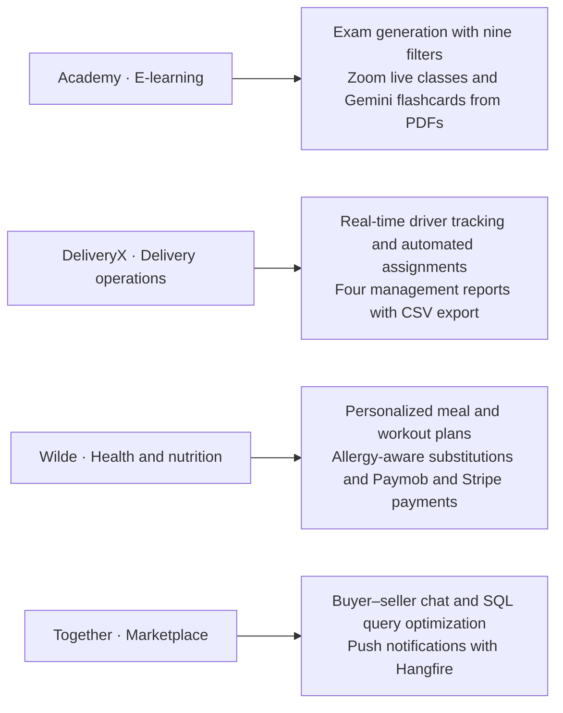

# 👋 Hi, I’m Basem Mohamed

**Software Engineer · .NET Backend Developer**

I’m based in Cairo and build REST APIs, SQL Server databases, and backend workflows for production web and mobile applications.

[Connect with me on LinkedIn](https://www.linkedin.com/in/basem10/)

## 🧰 Tech stack

      

- **Real-time and jobs** · SignalR, Hangfire, Quartz
- **Integrations and tools** · Zoom, Google Gemini, Paymob, Stripe, Azure App Service, Git

## 🛠️ Production projects

## 📂 Public repositories

- [Library Management API](https://github.com/basem1998/Library_Management_API) · C# API for books, patrons, and borrowing records.
- [Exam System Database](https://github.com/basem1998/exam_system_db) · T-SQL schema, stored procedures, and indexes.
- [Clinic Management System](https://github.com/basem1998/clinic-managment-system) · C# desktop application using Entity Framework.
